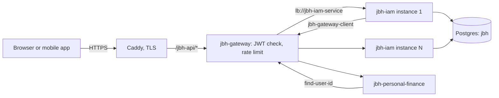

# Security policy and threat model - jbh-iam

## Reporting a vulnerability

Do not open a public issue.
Use GitHub private vulnerability reporting: **Security** tab → **Report a vulnerability**.
Only `main` is supported. It is the version that runs in production.

The rest of this file is the threat model. Security reviewers (human or AI) use it to judge a finding.
Rules for code review are in [`AGENTS.md`](AGENTS.md#code-review-rules).

## 1. Overview

`jbh-iam` issues and checks identity for the JBH system: sign-in, sign-up, Google sign-in,
JWT access tokens, refresh tokens, users, and user groups with invitations.
It is a Kotlin / Spring Boot service with its own Postgres database (`jbh`).

- Production: only Caddy is on the internet. `jbh-gateway` is the only way in.
  IAM, Postgres, and Consul are on the private Docker network `jbh-private`. They have no host ports.
- IAM can run as several identical instances. The gateway balances them through Consul.
- IAM calls `jbh-personal-finance` (invitation emails) through the gateway, with `jbh-gateway-client`.

## 2. Actors, assets, and trust boundaries

| Actor | Intended authority |
|-------|--------------------|
| Anonymous caller | Only `/jbh-api/auth/**` (sign-in, sign-up, Google, refresh, logout, name and email checks) and `/actuator/health`, `/actuator/info`. |
| User (`ROLE_USER`) | Own profile and own user id. Groups where they are an accepted member. Their own invitations. |
| Group owner | Update or delete their group. Remove members. The owner cannot be removed. |
| Admin (`ROLE_ADMIN`) | List all users and groups, read any profile, revoke tokens, read cache stats. |
| `jbh-gateway` | Trusted. Checks the access token signature before routing. Shares `JBH_JWT_SECRET`. |
| `jbh-personal-finance` | Calls `GET /jbh-api/users/find-user-id` with the user's own token. No extra rights. |
| Operator | Controls env vars, the VPS, and the database. Trusted. |

Assets:

- Password hashes (BCrypt), refresh token hashes (SHA-256), and the `JBH_JWT_SECRET` signing key.
- Access tokens (15 minutes) and refresh tokens (30 days). Both act as the user while they are valid.
- User emails, names, and Google subject ids.
- Group membership, ownership, and invitations.

Trust boundaries:

- **Internet → gateway → IAM.** Clients can send any JSON, header, or cookie to a routed path.
  The gateway check does not replace the IAM check: IAM checks the token again on every request.
- **User → user.** Each user can see and change only their own data. Each group is its own authorization domain.
- **User → admin.** Admin rights come only from `ROLE_ADMIN` in the database.
- **Instance → instance.** Instances share only Postgres. Each has its own memory cache.

## 3. Entry points

| Entry point | Who can reach it | Code |
|-------------|------------------|------|
| `/jbh-api/auth/**` | Anyone (public). Gateway rate limit: 10 per minute per IP on `signin`, `signup`, `google`. | `AuthController`, `GoogleAuthService`, `LogOutResource` |
| `/jbh-api/users/**` | Logged-in users. Some handlers are admin only. | `UserController` |
| `/jbh-api/user-groups/**` | Logged-in users. Owner or member checks in the service. | `UserGroupController`, `UserGroupServiceImpl`, `UserGroupMembershipServiceImpl` |
| `/jbh-api/admin/**` | Not routed by the gateway. Reachable only on port 9999 inside the private network. | `AdminTokenController`, `CacheStatsController` |
| `/actuator/health`, `/actuator/info` | Anyone who can reach port 9999. Consul uses health. | `AuthorizationRules` |
| `@Scheduled` refresh token cleanup | Every instance, daily at 02:00. | `ScheduledTasks` |

## 4. Controls already present

- Stateless security: `SessionCreationPolicy.STATELESS`. No server session.
- Access token: HS256, signed with `JBH_JWT_SECRET` (no default; the service stops without it).
  Claims `sub` (user id) and `token_type=ACCESS`. `JwtTokenProvider.validateToken` checks the signature and expiry only.
  Today this is safe: refresh tokens are random UUIDs, not JWTs.
- The JWT filter loads the user and roles on every request (`CustomUserDetailsService.loadUserById`).
- Refresh tokens: random, stored only as a SHA-256 hash. Rotation and revoke use one conditional
  `UPDATE ... WHERE revoked = false` (`revokeIfActive`). Only one caller wins, also across instances.
- Passwords: BCrypt.
- Cookies `JBH_TOKEN`, `JBH_REFRESH_TOKEN` (with the `__Secure-` prefix in production): `HttpOnly`,
  `SameSite=Lax`, `Secure` in production. CSRF protection is off, so `SameSite=Lax` and the single host matter.
- Google sign-in checks the token audience (`GOOGLE_CLIENT_IDS`) and requires a verified email before it links an account.
- CORS allows only `CORS_ALLOWED_ORIGINS`.
- Admin handlers call `requireAdminRole()`. Group handlers call `requireOwner` / `requireMember`.
- A denied action returns `403` through `ForbiddenException` and `GlobalErrorHandler`.

## 5. Threat scenarios and intended protections

| Boundary and possible failure | Intended protection | Code to review |
|-------------------------------|---------------------|----------------|
| User → admin: a new admin handler forgets `requireAdminRole()`. The URL rule `/admin/**` does not match `/jbh-api/admin/**`, so nothing else stops it. | Every admin handler calls `requireAdminRole()` first. | `AuthorizationRules`, `components/admin/` |
| User → other user: a lookup by group, invitation, or member id skips the membership check (IDOR). | Check owner or accepted member in the service for every read and write. | `UserGroupServiceImpl`, `UserGroupMembershipServiceImpl` |
| User → other user: a profile endpoint returns another user's email. | Personal data of other users is admin only. | `UserController` |
| Stolen refresh token used twice, maybe on two instances at the same time. | Conditional revoke: only one rotation succeeds; the second gets `401`. | `RefreshTokenService.rotate` |
| Token or secret in logs (access token, refresh token, Google ID token, `Authorization` header, password). | Log user ids only. | Every logger, `InvitationNotificationServiceImpl` |
| A new JWT type (for example a signed refresh or reset token) is accepted as an access token, because `validateToken` does not read `token_type`. | Any new JWT type gets its own `token_type`, and `validateToken` accepts only `ACCESS`. | `JwtTokenProvider` |
| Account takeover by Google sign-in with an unverified or foreign email. | Audience check and `emailVerified == true` before linking. | `GoogleAuthService` |
| Public auth endpoint leaks data (user enumeration through error messages or timing). | Same answer for unknown user and wrong password on sign-in. | `AuthController` |
| Weak or missing signing key. | No default for `JBH_JWT_SECRET`; at least 32 bytes. | `application.yml`, `JwtTokenProvider` |

## 6. Horizontal scaling assumptions

The service must stay correct with N instances. A finding that holds only with more than one instance is real.

- Each instance has its own Caffeine user cache. A write or evict (logout, user delete, role change)
  changes only the cache of the instance that served it.
- The JWT filter reads roles through that cache. So another instance can keep old roles or a deleted user
  for up to `CACHE_USER_EXPIRE_WRITE_MINUTES` (default 60). See section 7.
- One-time actions (token rotation, invitation accept, sign-up uniqueness) must be enforced by Postgres:
  unique constraints or conditional updates. Memory locks and `synchronized` do not work across instances.
- `@Scheduled` jobs run on every instance. They must be idempotent.
- Liquibase uses its lock table, so two instances starting together do not run a changeset twice.
  During a rolling deploy old and new code share one schema, so changesets must be backward compatible.
- Rate limits are in the gateway, per client IP. IAM has no rate limit of its own.

## 7. Known limitations

These are known and accepted for now. Report them only if a change makes them worse.

- **Stale roles across instances.** Role changes and user deletes reach other instances only when their
  cache entry expires (default 60 minutes). With one instance, the evict works at once.
- **Access tokens cannot be revoked.** Logout and admin revoke stop refresh tokens. An access token stays valid until it expires (15 minutes).
- **The `/admin/**` URL rule is dead code.** Admin protection depends only on `requireAdminRole()` in each handler.
- **Admin endpoints are not routed.** They are reachable only from the private network on port 9999.
- **Shared database user.** IAM and `jbh-personal-finance` use the same Postgres admin user.

## 8. Severity guide

- Start from who the attacker is (anonymous, user, group member, admin) and which boundary they cross.
- **Critical / High**: anonymous or normal user gets admin rights, another user's tokens, or another user's data;
  a token or secret leaks; a token can be forged or reused.
- **Medium**: a member gets owner rights in one group; personal data of a few users leaks to logged-in users;
  a bug that breaks a one-time action only with several instances.
- **Low**: needs operator access, or leaks only non-sensitive metadata.
- Out of scope: attacks that need the VPS, the database, or `JBH_JWT_SECRET`; missing headers that Caddy adds;
  denial of service that the gateway rate limit already covers.

## 9. When to update this file

Update it in the same pull request when you change authentication, token claims or cookies, roles, public paths,
group access rules, the user cache, scheduled jobs, or how IAM is deployed or scaled.
